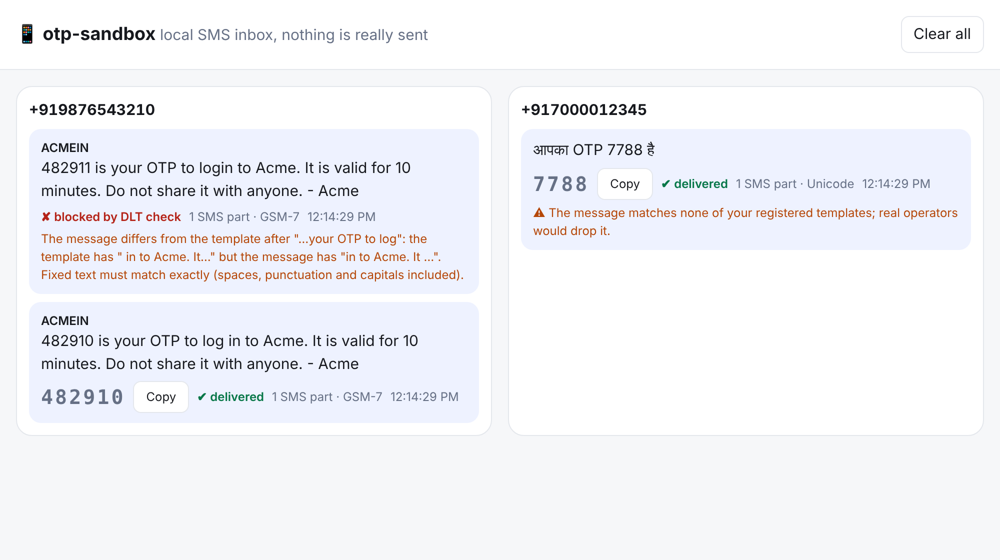

# otp-sandbox 📱

**Build and test OTP login without real SMS, DLT approval or a phone.**

`otp-sandbox` is a fake SMS gateway that runs on your computer. Your app sends SMS to it instead of a real provider.
You see every message in a web inbox, your automated tests can read the OTP from an API, and every message
is checked against your DLT templates the way Indian operators check them.



## Why

Sending SMS in India needs DLT registration: an entity ID, a 6-letter sender ID (header) and every template
pre-approved, which takes days. Then a single changed space or capital letter between your code and the
registered template, and operators **silently drop** the message. Developers end up:

- waiting days before they can test the login flow at all,
- burning paid SMS credits on every test run,
- reading OTPs off a teammate's phone,
- finding out in production that "login to" ≠ "log in to".

## Run it

Needs [Node.js](https://nodejs.org) 18+. No dependencies.

```bash
git clone https://github.com/aaura1177/otp-sandbox.git
```

```bash
cd otp-sandbox
```

```bash
node bin/otp-sandbox.js serve
```

Open **http://localhost:4010** for the inbox. Send a test SMS:

```bash
curl -X POST http://localhost:4010/api/sms -H "content-type: application/json" -d '{"to":"9876543210","message":"Your OTP is 482910"}'
```

## Point your app at it

Use the sandbox locally and your real provider in production. Switch with one environment variable:

- Node.js: [examples/sms.js](examples/sms.js)
- Laravel: [examples/SandboxSms.php](examples/SandboxSms.php)

### API

| Request | What it does |
| --- | --- |
| `POST /api/sms` `{"to","message","template_id?","sender?"}` | "Sends" an SMS. JSON or form-encoded. `200` delivered, `422` blocked by the DLT check, `400` bad number |
| `GET /api/otp/latest?to=9876543210` | The latest OTP sent to that number (`404` if none), for automated tests |
| `GET /api/sms?to=…` | All messages, newest first |
| `DELETE /api/sms` | Clear the inbox (do this before each test) |

Numbers are normalised: `9876543210`, `09876543210`, `+91 98765-43210` all become `+919876543210`.
Invalid Indian numbers are rejected, like a real gateway would.

### End-to-end tests

[examples/login.spec.js](examples/login.spec.js) is a Playwright test that logs in with a real OTP flow:
the app sends the SMS, the test reads `/api/otp/latest`, then types the code.

## DLT checks

### Check a template before you submit it for approval

```bash
node bin/otp-sandbox.js lint "Your OTP is {{otp}}. Valid 10 min" --sender acme
```

```
ERROR   "{{otp}}": {{name}} is template-engine syntax; DLT needs {#var#}.
INFO    OTP template: register it under the "Service Implicit" category (banks may use "Transactional").
ERROR   Sender ID (header) "acme" must be exactly 6 characters, letters for OTP/service SMS (e.g. "ACMEIN").
```

It checks the variable syntax (`{#var#}` and typed variables such as `{#numeric#}`, `{#url#}`), templates that are
too generic, variables placed next to each other, links that must be whitelisted, the sender ID format, and how many
SMS parts the message costs at full length (160 characters GSM-7, 70 for Hindi/Unicode).

### Check that your code's message matches the approved template

```bash
node bin/otp-sandbox.js lint "{#var#} is your OTP to log in to Acme. Do not share it with anyone." --message "1234 is your OTP to login to Acme. Do not share it with anyone."
```

```
NO MATCH The message differs from the template after "…your OTP to log": the template has " in to Acme. Do…" but the message has "in to Acme. Do …".
```

### Make the sandbox enforce your templates

Put your approved templates in a JSON file (see [examples/templates.json](examples/templates.json)):

```json
[{ "id": "1107160000000000001", "sender": "ACMEIN", "text": "{#var#} is your OTP to log in to Acme. ..." }]
```

```bash
node bin/otp-sandbox.js serve --templates templates.json --strict
```

Now any SMS your app sends that wouldn't pass DLT scrubbing comes back as `422` with the exact reason, and shows
as **blocked** in the inbox. You catch the mismatch on your laptop, not in production.

> The rules follow commonly documented DLT behaviour (exact fixed text, max 30 characters per variable). Each
> operator's portal has its own details, so always do a final test with your real provider.

## Test failure handling

```bash
node bin/otp-sandbox.js serve --delay 3000 --fail-rate 0.3
```

Slow answers and 30% random `503` errors let you check your loading state, retries and "Resend OTP" button.

## Use from a phone or emulator

```bash
node bin/otp-sandbox.js serve --host 0.0.0.0
```

Then use your computer's Wi-Fi IP (e.g. `http://192.168.1.5:4010`). The Android emulator reaches your computer at `http://10.0.2.2:4010`.
Only do this on a network you trust: the sandbox has no login.

## Safety

- Nothing is ever sent to a real phone. Messages live in memory and disappear when you stop the server.
- Listens on `127.0.0.1` only, unless you pass `--host`.

## Contributing

See [CONTRIBUTING.md](CONTRIBUTING.md). Wanted: provider-compatible endpoints (MSG91, Gupshup, Twilio-style) so apps
can switch by changing only the base URL, WhatsApp OTP simulation, and more DLT rule checks from real rejections.

## Licence

MIT, part of the [Aurateria](https://aurateria.com) open-source tools.
